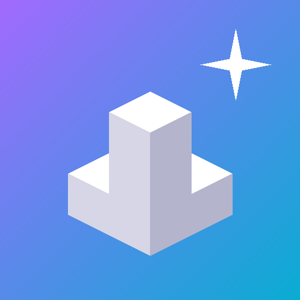

<p align="center"></p>

# AIConstructor

[](https://modrinth.com/plugin/aiconstructor) [](https://github.com/alanlapid/AIConstructor/actions)

**Build Minecraft structures from a text prompt or a photo, using the LLM of your choice.**

```
/aibuild a small wooden sailboat with white sails
/aibuild photo https://example.com/castle.png a castle like this one
```

The AI designs the build, you get a **ghost-block preview** in front of you that only you can see and can **drag along X/Y/Z with editor-style handles**, and after confirming it is placed **block by block**. Every build can be **undone**.

- **Paper** or **Spigot** 26.3 (one jar for both) · Java 25
- Works with **Gemini, Claude, any OpenAI-compatible API, and local models** (Ollama, LM Studio, vLLM…)
- Each server uses **its own API key**. Nothing goes through third-party servers.

## Features

- **4 connectors**
  - `gemini`: Google AI Studio (has a free tier)
  - `anthropic`: Claude, through the official Anthropic Java SDK
  - `openai`: OpenAI, OpenRouter, Groq, DeepSeek, Mistral, Together, LM Studio, vLLM, LocalAI… anything that speaks the Chat Completions API
  - `ollama`: local models through Ollama's native API (no key needed), or Ollama Cloud with an API key
- **Model rotation.** If a model is overloaded or out of quota, the next one in the list is tried automatically. Players see every attempt live.
- **Structured output.** The model returns a JSON plan made of shapes (`fill`, `walls`, `hollow_box`, `line`, `cylinder`, `sphere`, `pyramid`, `block`). Models without structured output are supported too.
- **Photos as reference** for models with vision. Downloads are size-limited and cannot reach private or internal addresses.
- **Safe by default**
  - Never overwrites chests, signs or other block entities.
  - Blocked block list (TNT, lava, command blocks, portals…).
  - Size and block limits.
  - Respects **WorldGuard** regions, including ProtectionStones.
- **Limits per player.** Cooldown, plus a daily limit per permission (`aiconstructor.limit.<n>`). Failed AI calls are not counted.
- **Translatable.** Ships with English and Spanish (`lang/*.yml`, MiniMessage format).

### Moving the preview

Colored arrows stick out of the preview, like the move gizmo of a 3D editor: red for X, green for Y, blue for Z. **Left-click an arrow** (from up to 64 blocks away) to grab it; the build then follows where you look, along that axis only, snapping to whole blocks. **Left-click again or sneak** to drop it. Clickable ±1/±5 buttons in chat and `/aibuild move` do the same thing precisely. Moves that would leave the world height, go more than `preview.max-move-distance` blocks from where the build appeared or land in a protected region are refused.

## Installation

1. Drop `AIConstructor-x.y.z.jar` in `plugins/` and start the server once. The server downloads the Anthropic SDK library automatically on first start.
2. Edit `plugins/AIConstructor/config.yml`: choose `provider.type`, set `provider.api-key` and `provider.models`.
3. Run `/aibuild reload`.

### Provider examples

**Gemini (free tier)**
```yaml
provider:
  type: gemini
  api-key: "env:GEMINI_API_KEY"   # or paste the key
  models: [gemini-3.8-flash, gemini-3.7-flash, gemini-3.5-flash]
```

**Claude**
```yaml
provider:
  type: anthropic
  api-key: "env:ANTHROPIC_API_KEY"
  models: [claude-opus-5]
```

**OpenRouter (hundreds of models)**
```yaml
provider:
  type: openai
  base-url: "https://openrouter.ai/api/v1"
  api-key: "env:OPENROUTER_API_KEY"
  models: [openai/gpt-5-mini]
```

**Local with Ollama**
```yaml
provider:
  type: ollama
  base-url: "http://localhost:11434"
  models: [qwen3:14b]
  vision: false        # true only for vision models such as llava / qwen2.5vl
```

**Ollama Cloud**
```yaml
provider:
  type: ollama
  base-url: "https://ollama.com"
  api-key: "env:OLLAMA_API_KEY"
  models: [minimax-m3]   # cloud API names have no ":cloud" suffix
  vision: false
  ollama:
    think: false         # thinking models can otherwise spend the whole token budget reasoning
```

**LM Studio / vLLM (OpenAI-compatible, local)**
```yaml
provider:
  type: openai
  base-url: "http://localhost:1234/v1"
  api-key: ""
  models: [your-loaded-model]
  openai:
    response-format: json_schema   # use json_object or none if your server does not support it
```

Small local models (under ~7B parameters) often produce simple or invalid plans. For good results use a strong model.

## Commands

| Command | Description |
|---|---|
| `/aibuild <prompt>` | Design a build from a description |
| `/aibuild photo <url> [prompt]` | Design a build from a photo (direct PNG/JPG/WEBP link) |
| `/aibuild move <x\|y\|z> <n>` | Move the preview along an axis. Also `move <dx> <dy> <dz>` and `move <up\|down\|forward\|back\|left\|right\|north\|south\|east\|west> [n]`. Clickable ±1/±5 buttons appear in chat |
| `/aibuild confirm` | Place the previewed build |
| `/aibuild cancel` | Discard the preview, or stop a build in progress |
| `/aibuild undo` | Remove your last build (history of 5 by default) |
| `/aibuild status` | Uses today, pending build, provider and models |
| `/aibuild reload` | Reload config, language and system prompt |

Aliases: `/aiconstructor`, `/construir`.

## Permissions

| Permission | Default | Description |
|---|---|---|
| `aiconstructor.use` | op | Generate builds from text |
| `aiconstructor.photo` | op | Generate builds from photos |
| `aiconstructor.admin` | op | `/aibuild reload` |
| `aiconstructor.limit.<n>` | – | Daily limit of `n` builds (highest wins) |
| `aiconstructor.bypass.limits` | false | No cooldown, no daily limit |
| `aiconstructor.bypass.protection` | false | Build inside regions the player could not normally build in |

## Configuration

See the fully commented [`config.yml`](src/main/resources/config.yml). You can tune the building style by editing `plugins/AIConstructor/system_prompt.txt`.

## Building from source

Requires JDK 25 and Maven:

```
mvn package
```

The jar is written to `target/`.

## License

[GPL-3.0](LICENSE). You can use, modify and redistribute it; modified versions must stay open source under the same license.
